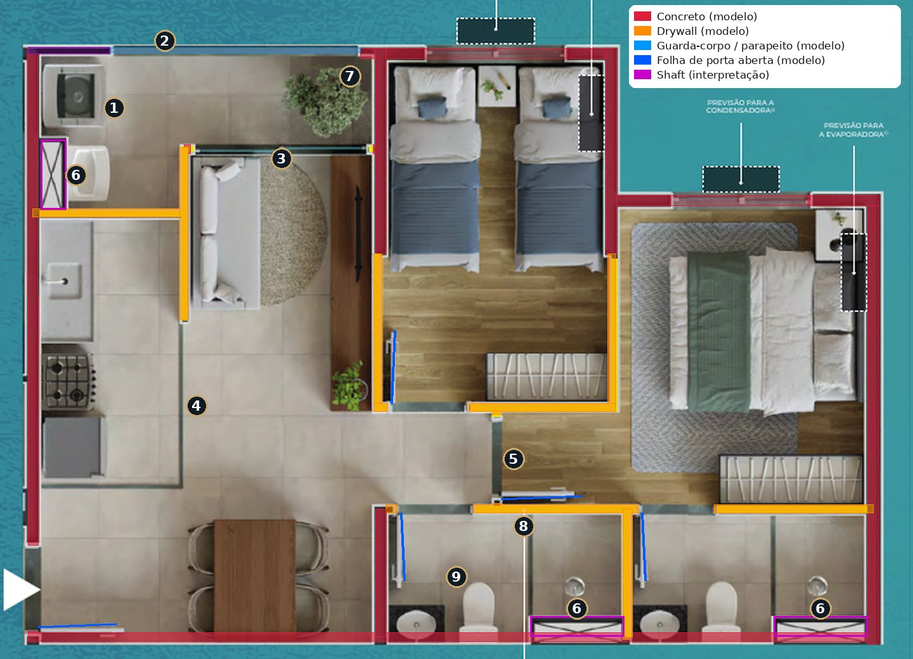

# Etapa 1 — Conferência da geometria com a planta original

**Unidade:** Orla Guanabara · 2 quartos com suíte e varanda · 45,66 m²
**Referência:** Book oficial Emccamp, página 17 (planta humanizada, **sem cotas**)
**Arquivo do modelo:** `src/layout/orla-guanabara/apto-45m2.ts` (status `draft`)

> ⚠️ Esta etapa trata **apenas da geometria**. Paredes brancas, pisos procedurais e
> esquadrias simplificadas são andaimes de conferência e **não representam o visual
> final**. O fotorrealismo (modelos detalhados, PBR, iluminação pré-calculada) é a
> etapa seguinte e só começa após a aprovação desta conferência.

## Como conferir

- **No tour:** modo *Planta 3D* → **Comparar com a planta original**. A câmera passa
  para uma vista superior quase ortogonal e a imagem do book é sobreposta ao modelo,
  com controle de transparência.
- **Imagens:**
  - `conferencia-anotada.jpg` — modelo desenhado sobre a planta, com os pontos a conferir numerados;
  - `sobreposicao-50.jpg` — captura do tour com a planta a 50 %;
  - `modelo-vista-superior.jpg` e `planta-3d.jpg` — modelo sem a planta;
  - `vistas-primeira-pessoa.jpg` — entrada, estar → varanda, circulação, quarto 2.
- **Medidas:** `medidas.md` (gerado automaticamente a partir do modelo).

## Resultado da verificação automática

O teste `src/layout/orla-guanabara/apto-45m2.test.ts` lê a imagem da planta e confere o
modelo pixel a pixel:

| Verificação | Resultado |
|---|---|
| Contorno externo = área privativa declarada (45,66 m²) | ✔ 45,66 m² |
| Escala coerente com objetos padrão (cama de solteiro 0,88 m) | ✔ 0,88 m |
| Cada trecho de parede ≥ 20 cm coincide com traço de parede na planta (≥ 85 % das amostras, faixa ±4 cm) | ✔ 17 paredes avaliadas: 16 com 96–100 %, parede sul com 87 % (as outras 2 são quase só vão: porta da varanda e porta da suíte) |
| Centro de cada vão de porta livre de alvenaria/drywall na planta | ✔ 6 de 6 portas |
| Ponto inicial fora de obstáculos; vãos sem sobreposição | ✔ |

**Soma das áreas internas modeladas:** 40,84 m². A diferença para 45,66 m² (4,82 m², 10,6 %)
corresponde às paredes — proporção típica para essa tipologia.

## O que está confirmado × estimado

| Item | Situação |
|---|---|
| Área privativa 45,66 m² | **Confirmado** (book) |
| Ambientes, vizinhanças e circulação | **Confirmado** (topologia da planta) |
| Posição e lado de abertura das portas | **Confirmado** (desenho das folhas) |
| Paredes de drywall × concreto | **Confirmado** (legenda amarela) |
| Posição e largura de paredes, portas e janelas | **Medido na imagem** — incerteza típica ±5–10 cm |
| Espessuras (concreto ≈ 0,10 m medido; drywall 0,08 m adotado) | **Medido / adotado** |
| Pé-direito 2,50 m; portas 2,10 m; janelas: peitoril 1,00 m, verga 2,10 m; guarda-corpo 1,10 m | **Adotado** — valores técnicos típicos, não oficiais |

## Pontos a conferir (numerados na imagem anotada)

| # | Ponto | Como foi modelado | Decisão necessária |
|---|---|---|---|
| 1 | **Varanda com área de serviço integrada** (máquina e tanque) | Um único ambiente "Varanda / Serviço", sem divisória | Confirmar interpretação (provisória, conforme combinado) |
| 2 | **Borda da varanda** | Faixa cinza = guarda-corpo de vidro h = 1,10 m; trecho escuro estreito atrás da máquina = parapeito opaco h = 1,10 m | Tipo de guarda-corpo; o trecho atrás da máquina pode ser parede inteira |
| 3 | **Porta de vidro sala ↔ varanda** (≈ 1,80 m) | Vão livre em toda a largura; montante central visível na planta | Qual folha é móvel (de correr) e qual é fixa |
| 4 | **Linha cinza fina** contornando cozinha e parte do estar | **Não** modelada como parede | Provável rebaixo de gesso ou troca de piso — confirmar |
| 5 | **Porta da suíte** (vão medido ≈ 0,88 m) | Porta ocupando todo o vão entre o quarto 2 e os banheiros | Largura acima do usual (0,70–0,80 m): pode haver trecho fixo de parede |
| 6 | **Retângulos com "X"** (sob os chuveiros e na área de serviço) | Shafts de altura total | Confirmar: shaft, prumada ou aquecedor a gás (área de serviço) |
| 7 | **Elemento escuro no canto da varanda**, junto ao vaso | Não modelado | Pode ser pilar/encontro estrutural ou sombra do vaso |
| 8 | **Legenda "Paredes removíveis (1)"** | Nenhuma parede marcada como removível | A seta da legenda é ambígua — qual parede é removível? |
| 9 | **Banheiros sem janela** | Sem janelas (nenhuma aparece na planta) | Confirmar ventilação por shaft/duto |

### Outras observações

- **Esquadrias:** só as larguras das janelas foram medidas; tipo (correr / maxim-ar), divisão
  de folhas e alturas reais virão da planta de esquadrias ou do memorial.
- **Ar-condicionado:** as previsões de condensadora (externas) e evaporadora (internas) estão
  registradas e serão representadas na etapa de detalhamento.
- **Orientação solar, andar e vista:** desconhecidos. O sol e a vista externa permanecem
  neutros até recebermos a implantação.
- **Resolução da imagem:** a página tem 1500 px de largura (≈ 1,3 cm por pixel). Uma versão
  em PDF/alta resolução, ou a planta de contrato com cotas, reduz a incerteza para poucos
  milímetros — basta corrigir os valores em `apto-45m2.ts` e rodar `npm run check`.

## Como corrigir uma medida

Todas as coordenadas estão em **pixels da página do book**, com a calibração explícita no
topo do arquivo. Para corrigir:

1. Ajuste o valor (px) da parede ou do vão em `src/layout/orla-guanabara/apto-45m2.ts`.
2. Se houver cota oficial, marque `provenance: 'confirmed'`.
3. `npm run check` (testes de coincidência com a planta) e `npx vite-node scripts/plan-report.ts`
   + `python3 scripts/annotate-plan.py` para regenerar este material.

## Próxima etapa (após aprovação)

Detalhamento fotorrealista conforme `docs/FOTORREALISMO.md`: modelagem com Blender sem
interface a partir deste mesmo layout, materiais PBR e mobiliário de bibliotecas CC0
(Poly Haven / ambientCG — exigirá liberar esses domínios na rede do ambiente), iluminação
global pré-calculada e exportação otimizada para celular e computador.
