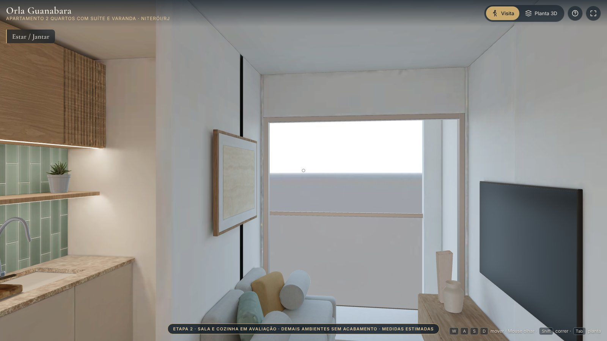
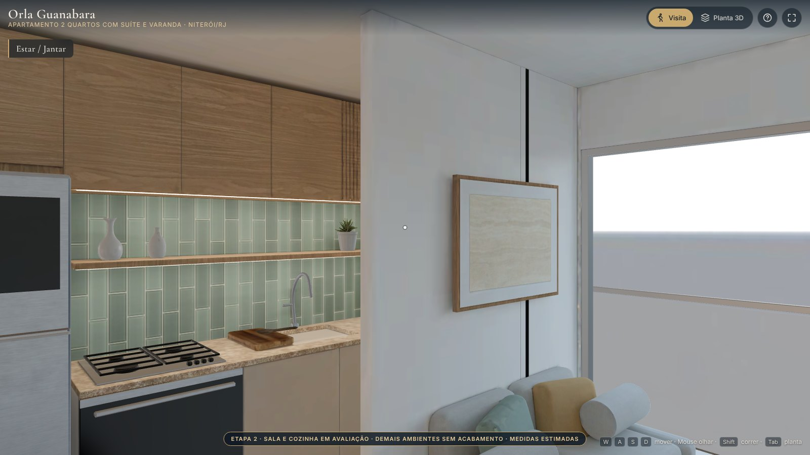
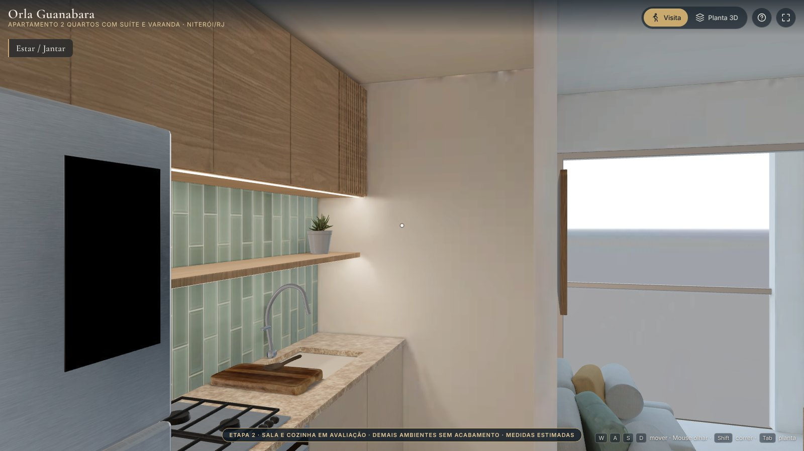
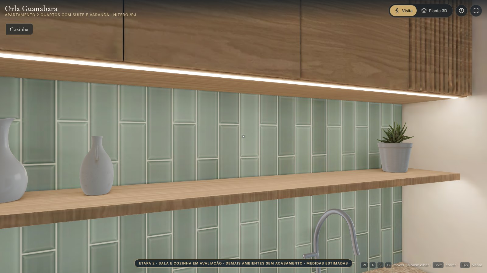
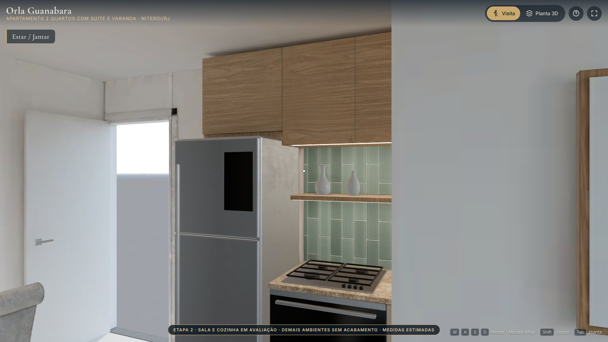
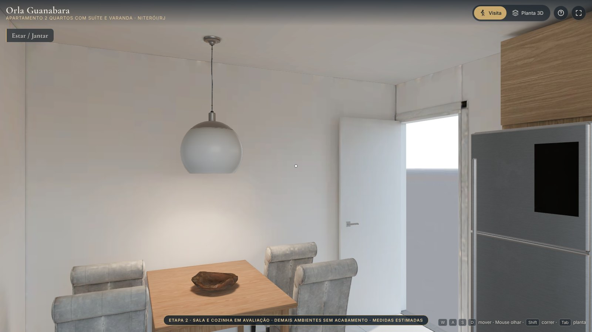
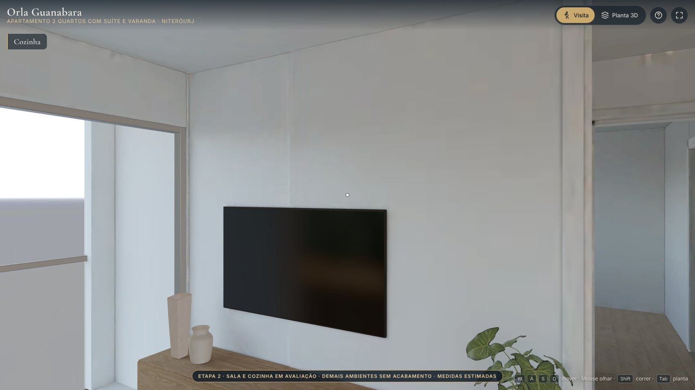
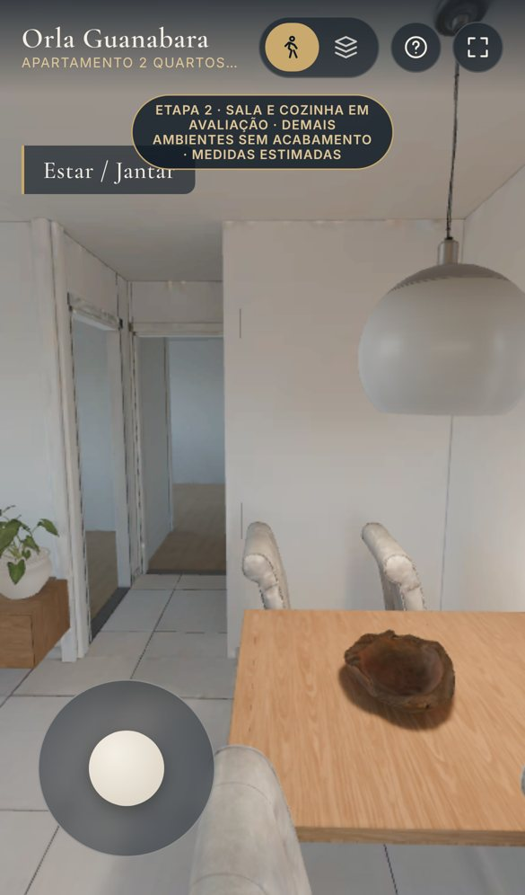

# Etapa 2 — Sala integrada à cozinha (para avaliação)

**Escopo:** só a sala de estar/jantar, a cozinha e a circulação foram detalhadas.
Quartos, banheiros e varanda continuam apenas com arquitetura e luz pré-calculada,
sem mobiliário nem acabamentos definitivos, até a aprovação desta etapa.
A geometria aprovada na Etapa 1 e a navegação não foram alteradas.

## Capturas (tour em tempo real, computador)

| | |
|---|---|
|  Sala → varanda |  Cozinha e estar |
|  Cozinha (ponto de vista da perspectiva do book) |  Revestimento, prateleira e LED |
|  Cooktop, forno e geladeira |  Jantar e entrada |
|  Parede da TV |  Celular |

`referencia-blender-*.jpg`: render com path tracing da mesma cena, usado como alvo
de qualidade para o tour.

## O que foi feito

- **Marcenaria da cozinha** seguindo a perspectiva oficial: aéreos em carvalho claro
  com módulo ripado, prateleira com fita de LED, revestimento verde-azulado em
  peças verticais, bancada em granito bege, cuba inox sob a bancada, torneira
  gourmet, cooktop 4 bocas com grelhas de ferro, forno embutido em vidro preto,
  geladeira inox com painel preto.
- **Sala** conforme o layout do book: sofá de 2 lugares com rolos laterais,
  tapete redondo, rack/painel em madeira, TV 55", mesa com 4 cadeiras estofadas,
  pendente de vidro, planta, vasos e objetos de decoração.
- **Arquitetura** detalhada: porcelanato 60×60 em placas com junta e variação
  por peça, rodapés, portas com batente, guarnição e maçaneta, soleiras em
  granito, esquadrias de alumínio.
- **Materiais PBR** (cor, relevo, rugosidade e metal) de bibliotecas **CC0**:
  ver `public/cenas/orla-45m2/creditos.json` (22 assets do Poly Haven e do ambientCG).
- **Iluminação natural pré-calculada** (Cycles): céu físico + sol entrando pela
  varanda, rebatimentos e sombras suaves gravados em lightmaps de 2048 px com
  denoise Intel OIDN; reflexos em tempo real (inox, vidro, porcelanato, laca)
  a partir de um cubemap capturado na própria sala.

## Resultados dos testes

- Typecheck, lint, 19 testes unitários e build de produção: ✔
- Teste de ponta a ponta (`scripts/smoke.cjs`, computador + iPhone emulado): **11/11** ✔
  movimento WASD, câmera H/V, colisão com parede, **colisão com a bancada da cozinha**,
  troca para planta 3D, entrar pelo piso, joystick, arraste para olhar, sem erros no console.

## Tamanho e carregamento (`scripts/metrics.cjs`)

| Perfil | Baixado | Cena pronta* | Por quadro |
|---|---|---|---|
| Computador · banda larga 50 Mbit/s | 13,8 MB | 9,2 s | 34 chamadas de desenho · 195 mil triângulos |
| Celular · 4G 12 Mbit/s | 5,8 MB | 13,9 s | 31 chamadas · 189 mil triângulos |
| Celular · 4G fraco 5 Mbit/s | 5,8 MB | 17,9 s | 31 chamadas · 189 mil triângulos |

\* Medido em navegador emulado **sem GPU** (renderização por software e CPU do
celular desacelerada 4×). Só o download corresponde a ~2,5 s (computador),
~4 s (4G) e ~9 s (4G fraco); o restante é decodificação e envio das texturas à
GPU, que em aparelhos reais costuma ser bem mais rápido. A interface aparece em
cerca de 1 s e a cena carrega com barra de progresso.

**FPS:** não pode ser medido de forma representativa neste ambiente (sem GPU).
A cena foi construída para ser leve em tempo real: sem sombras dinâmicas, ~30
chamadas de desenho e ~190 mil triângulos. Para medir no seu aparelho, abra a
prévia com `?fps=1`.

## Pontos de atenção / próximos refinamentos possíveis

- A vista pelas janelas é um céu claro neutro: a orientação solar, o andar e a
  vista real (Baía de Guanabara) ainda não foram informados, e não foram inventados.
- A porta de correr da varanda aparece só com o caixilho (ponto 3 da conferência
  em aberto: qual folha é móvel).
- Pequenos objetos de decoração recebem luz do ambiente capturado (não do bake);
  se necessário, podem ganhar sombras de contato pré-calculadas.
- Pode-se elevar o lightmap para 4096 px no computador (mais nitidez nas sombras
  finas) ao custo de ~1 MB a mais e de um bake mais longo.
